# MetroKeys

MetroKeys is an Android keyboard inspired by the Windows Phone 8.1 keyboard: flat square keys, a scrolling
suggestion bar above the keys, an application bar below them, word prediction, autocorrection and shape writing
(swiping across the letters), plus a settings app in the same flat, typographic style.

MetroKeys is an independent project and is not affiliated with or endorsed by Microsoft. Windows and Windows Phone
are trademarks of their respective owners. MetroKeys contains no code, data, images, sounds or fonts of the original
keyboard; the only bundled font is the open-source Selawik (SIL Open Font License). It is a clean-room implementation
written from a functional specification (see [How it is made](#how-it-is-made)).

> **Made with AI:** MetroKeys is written and maintained with the help of Claude Opus 5.5 (Anthropic). See [How it is made](#how-it-is-made).

Version 0.6.2 (see the [changelog](CHANGELOG.md)). Android 8.0 (API 26) or newer.

<p>
  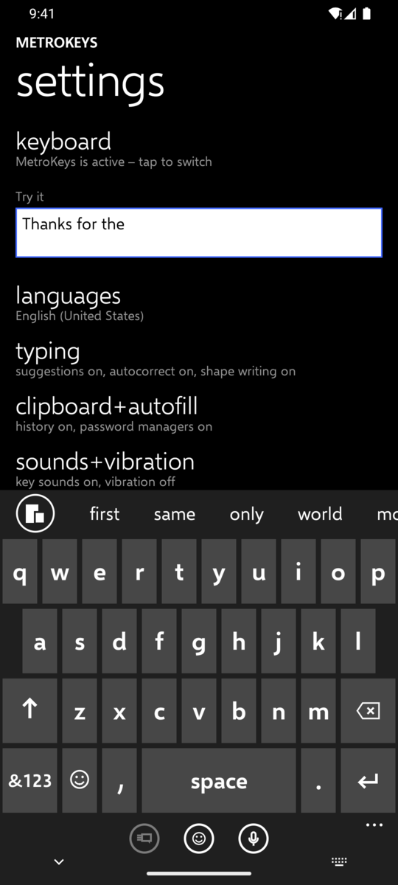
  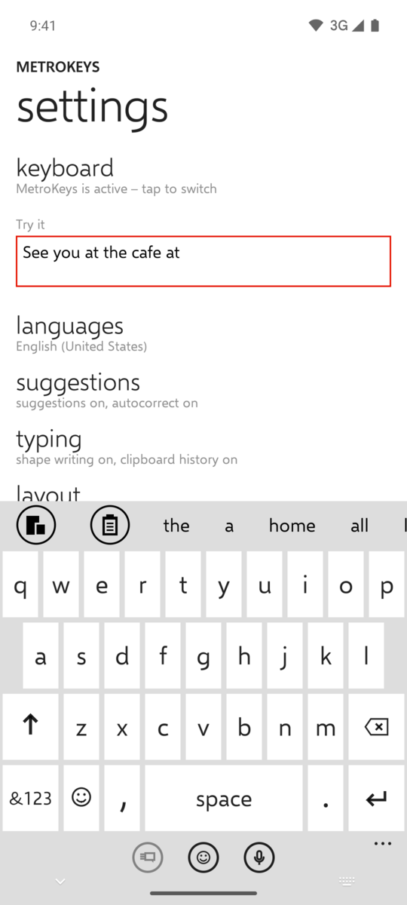
  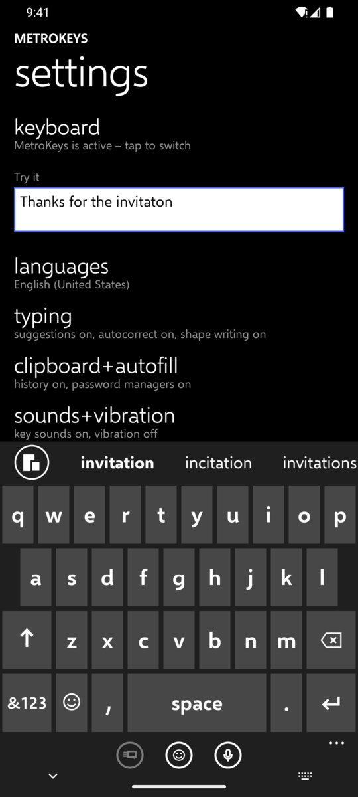
  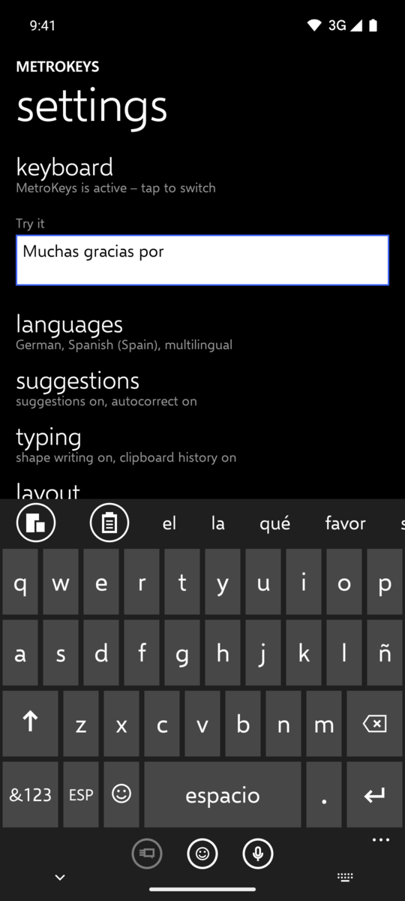
  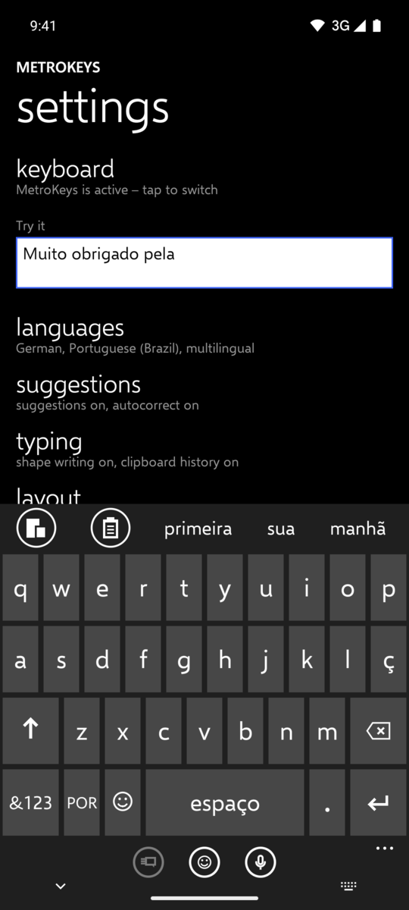
  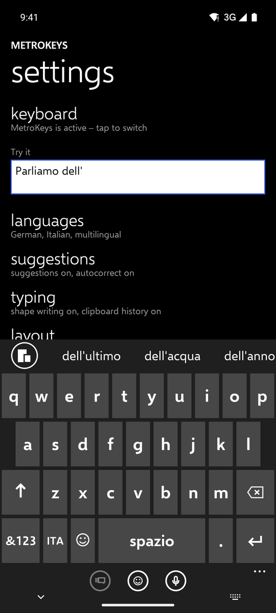
</p>

## Features

**Typing**
- Keyboard languages: German (QWERTZ), English (US, QWERTY), Spanish (Spain, QWERTY with ñ), Portuguese (Brazil,
  QWERTY with ç) and Italian (QWERTY), each with its own dictionary, symbol pages, number, phone and PIN pads, and long-press alternates
  for accented letters and symbols (Spanish: ¿ and ¡ on the long press of the period key).
- Word suggestions while typing, next-word prediction and autocorrection, with an undo by tapping the word you
  typed. Corrections are case-aware, learn from what you type, add missing accents in Spanish, Portuguese and Italian
  ("cancion" → "canción", "informacao" → "informação", "perche" → "perché") and, in English, Spanish, Portuguese and
  Italian, fix a missing space ("ofthe" → "of the", "porfavor" → "por favor"). Italian elisions are handled by the
  prediction: "lacqua" → "l'acqua", "c'e" → "c'è", and after "dell'" the bar offers whole words ("dell'anno").
- Shape writing: slide across the letters to write a word; the trace follows your finger.
- Typing in several languages at once (multilingual mode): a language key cycles through all enabled languages,
  suggestions come from up to three of them and corrections follow the language of the sentence.
- Automatic capitalisation, double-space period, smart spacing around punctuation, and spelling marks for
  unknown words in the text field.
- Learned words stay on the device; the settings list every learned word and let you forget any of them, and you
  can also forget a learned word by holding it in the suggestion bar.

**Beyond the letters**
- Emoji page with categories, recently used emoji and text smileys (Unicode emoji 18.0; emoji your phone cannot
  draw are hidden).
- Application bar below the keys with three round buttons (by default: the field's action such as send or search,
  emoji, voice input) and a "…" menu with switch keyboard, clipboard history and keyboard settings. What each button
  does when tapped or held is chosen in a live preview of the bar, from a grid of 15 actions or any installed app.
- Clipboard history for text and images, with pinning; a chip in the suggestion bar offers what you copied in the
  last two minutes, so pasting is one tap.
- Voice input through the speech recognition service of your phone.
- Password-manager suggestions shown inline in the suggestion bar (Android 11 and newer).
- Hardware keyboard support with a compact suggestion-only bar.
- TalkBack support for keys, suggestions and panels.

**Settings app**
- Pages for languages, suggestions, typing, layout (keyboard height, app bar and its buttons), theme,
  sounds+vibration and data+info (learned words, licences, about).
- Dark and light theme (following the system or fixed), 20 accent colours for the keyboard and the app, high
  contrast.
- Key sounds and vibration, with your own sound files; your own fonts for the keyboard.
- English and German user interface, independent of the system language (Android 13 and newer).

<p>
  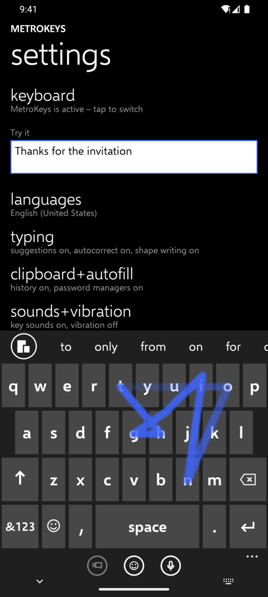
  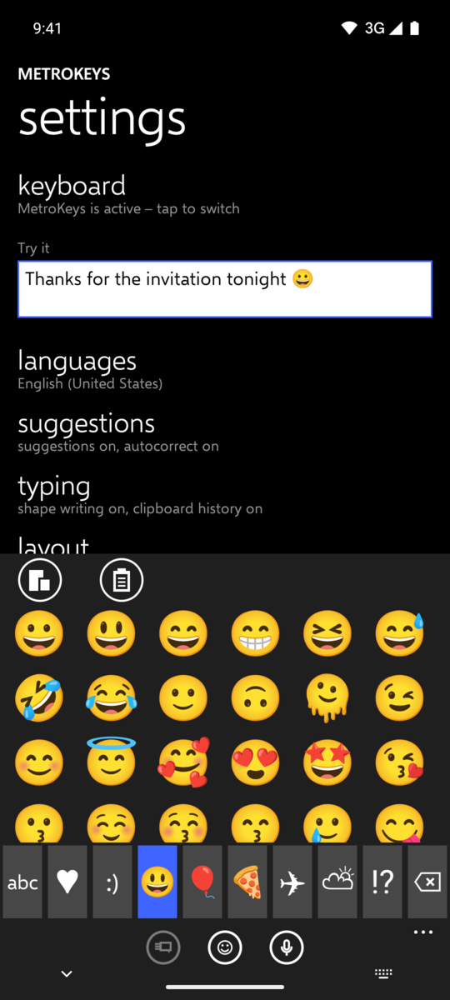
  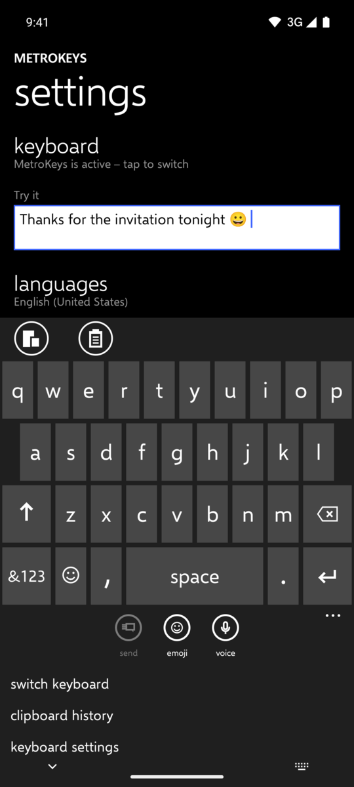
</p>
<p>
  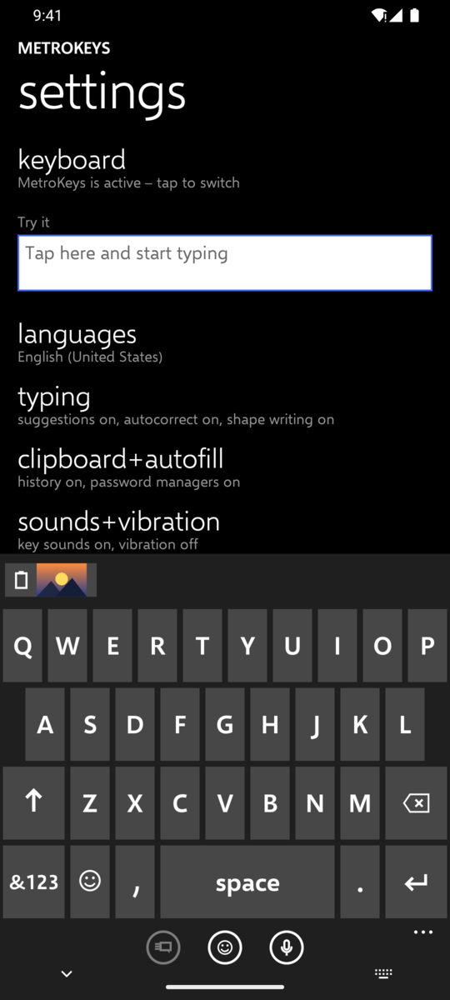
  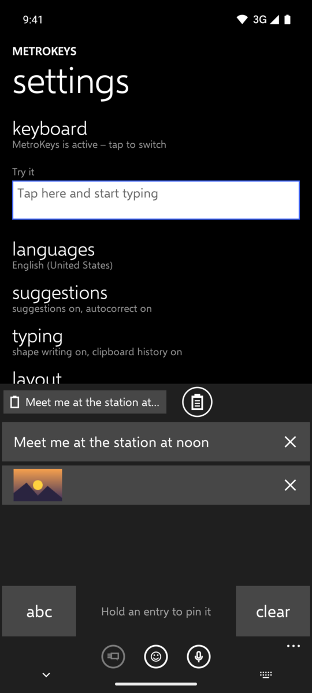
  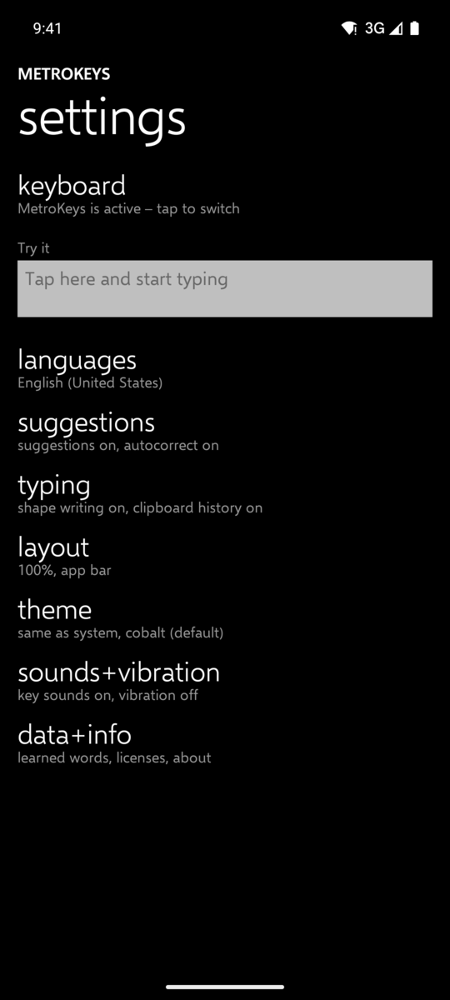
</p>
<p>
  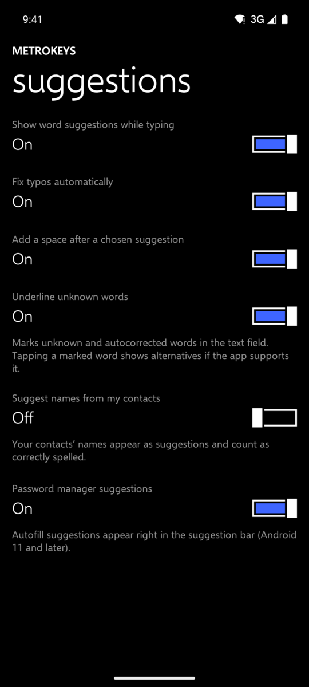
  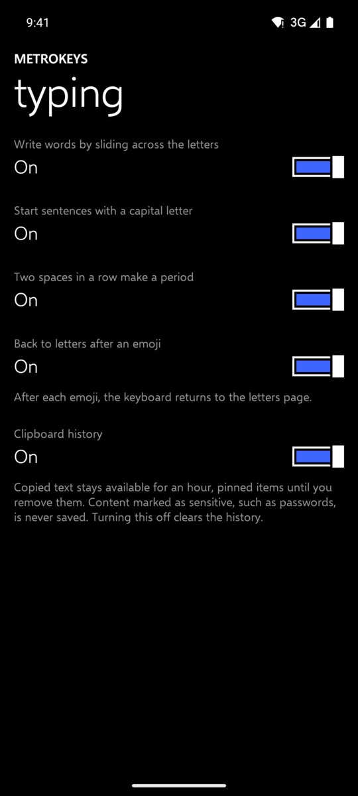
  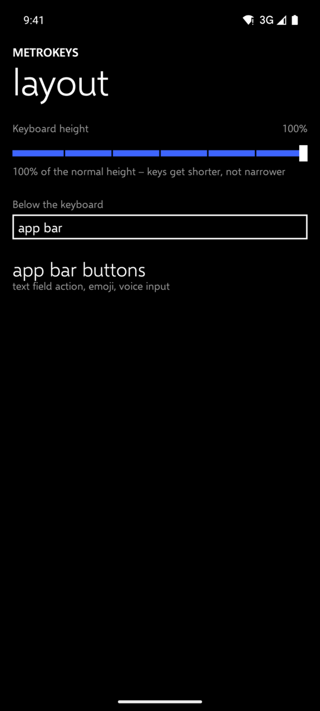
</p>
<p>
  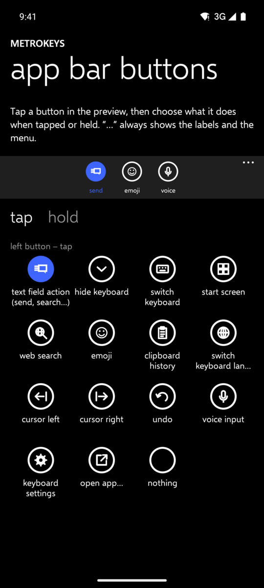
  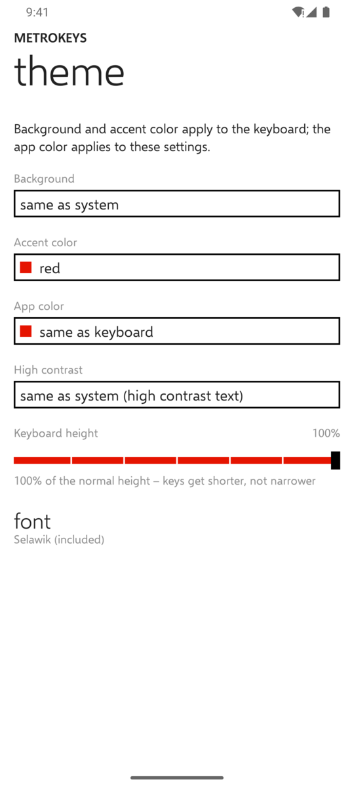
</p>

## Install and enable

1. Download the APK of the latest version from this repository's
   [releases page](https://github.com/itsDNNS/MetroKeys/releases) and install it on your phone. When the phone asks,
   allow installing apps from the source you use (browser or file manager).
2. Open **MetroKeys** from the app drawer. The first item on the settings page guides you through two steps:
   - **turn on**: opens the Android keyboard settings; switch MetroKeys on and confirm the notice Android shows for
     every third-party keyboard.
   - **choose**: pick MetroKeys as the current keyboard.
3. Tap the **Try it** field on the same page and start typing.
4. Optional: under **languages**, enable further keyboard languages (German, English, Spanish, Italian, Portuguese) and choose the app
   language (English or German); under
   **suggestions**, turn on contact names as a word source (asks for the contacts permission); under **layout →
   app bar buttons**, choose what the three buttons below the keys do.

To switch back to another keyboard, use the keyboard switcher of Android or the **switch keyboard** entry in the
"…" menu of the application bar.

A demo script for presenting the app is in [docs/DEMO.md](docs/DEMO.md).

## Privacy

- MetroKeys has **no internet permission**: it cannot send anything anywhere. There are no analytics, no ads and no
  crash reporting. The link under **data+info → about** opens this repository in your browser.
- Learned words, the clipboard history (including copied images) and imported fonts and sounds are stored in the
  app's private storage on the device and are excluded from Android backups and device transfers. Only the settings
  themselves may be backed up.
- Copied text expires from the history after an hour unless pinned; content that apps mark as sensitive (such as
  passwords) is never saved.
- Contact names are only read when you turn that setting on, and are kept in memory only.
- Voice input uses the speech recognition service installed on your phone; that service, not MetroKeys, processes
  the audio and follows its own privacy policy. The web search action hands the query to a search app or browser.
- You can delete everything the keyboard has learned under **data+info**.

## Building

Requirements: JDK 21 and the Android SDK with platform 37 (`platforms;android-37.0`, build tools 37.0.0).

```sh
./gradlew :engine:test testDebugUnitTest lintDebug assembleDebug   # tests, lint, debug APK
./gradlew assembleRelease                                         # release APK (minified with R8)
```

The debug APK is written to `app/build/outputs/apk/debug/`, the release APK to `app/build/outputs/apk/release/`.

**Release signing.** If a file `keystore.properties` exists in the repository root, the release APK is signed with
it; otherwise the release build stays unsigned (`app-release-unsigned.apk`). The file is git-ignored and never
committed:

```properties
storeFile=keystore/metrokeys-release.jks
storePassword=…
keyAlias=…
keyPassword=…
```

`storeFile` is resolved relative to the repository root. Check a signed APK with
`apksigner verify --print-certs app/build/outputs/apk/release/app-release.apk`.

**Continuous integration.** [.github/workflows/build.yml](.github/workflows/build.yml) runs the tests, lint and the
debug build on every push and pull request to `main` and uploads the debug APK and the reports. Releases are built
and signed locally; the signed APK is attached to the GitHub release by hand.

**Code layout.** `engine/` is a pure Kotlin/JVM library with prediction, autocorrection, shape writing and the
dictionaries ([docs/ENGINE.md](docs/ENGINE.md)); `app/` is the Android app with the input method and the settings
([docs/APP.md](docs/APP.md)). `tools/` contains the scripts that build the dictionaries and the emoji list from their
public sources ([docs/DATA-SOURCES.md](docs/DATA-SOURCES.md)).

## How it is made

MetroKeys is written and maintained with the help of Claude Opus 5.5, Anthropic's AI model: the code, the tests and
the documentation are developed in working sessions with the model and reviewed, tested and released by the author.

It was built as a clean-room re-implementation; see [CLEAN-ROOM.md](CLEAN-ROOM.md).

## Licence

Copyright © 2026 Dennis Braun. MetroKeys is free software licensed under the GNU General Public License v3.0 only
(GPL-3.0-only); see [LICENSE](LICENSE). You may use, study, share and modify it under the terms of that licence. It
comes without any warranty.

MetroKeys is not affiliated with or endorsed by Microsoft. Windows and Windows Phone are trademarks of Microsoft
Corporation.

## Third-party credits

The bundled third-party components keep their own licences:

- **Selawik font** (the bundled typeface): © Microsoft Corporation, licensed under the SIL Open Font License 1.1,
  Reserved Font Name "Selawik"; used unmodified. Source: https://github.com/microsoft/Selawik (release 1.01).
- **Dictionaries** (word lists and word-pair tables, licensed as data under CC BY-SA 4.0, not under the GPL), built
  from:
  - FrequencyWords by Hermit Dave (OpenSubtitles 2018), CC BY-SA 4.0;
  - Wiktionary (de.wiktionary.org, es.wiktionary.org, pt.wiktionary.org, it.wiktionary.org and the Spanish,
    Portuguese and Italian sections of en.wiktionary.org), CC BY-SA 4.0;
  - Tatoeba sentences (tatoeba.org), CC BY 2.0 FR;
  - SCOWL by Kevin Atkinson and others (wordlist.aspell.net), SCOWL licence (notice shipped verbatim);
  - Mozilla Common Voice sentences, CC0 1.0.
- **Emoji data**: Unicode `emoji-test.txt` (Emoji 18.0), Unicode License v3.
- **Libraries**: AndroidX, Jetpack Compose, Navigation 3 and Kotlin libraries, Apache License 2.0.

Versions, hashes and the full attribution texts are listed in [docs/DATA-SOURCES.md](docs/DATA-SOURCES.md); the app
shows the GPL and every third-party licence text under **data+info → licenses**. The app icon is MetroKeys' own
design.
